

   
  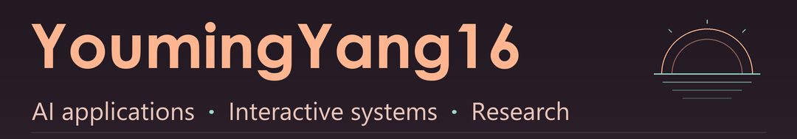

  
  
  

  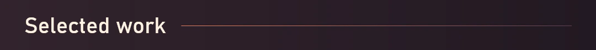 
  <a href="https://github.com/YoumingYang16/my-project3"><picture><source media="(max-width: 620px)" srcset="https://raw.githubusercontent.com/YoumingYang16/YoumingYang16/main/assets/portfolio/city-mobile.webp" />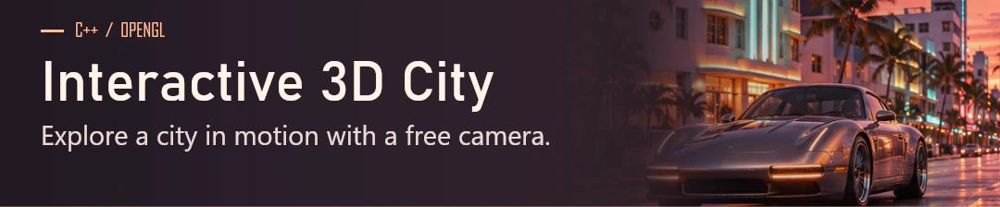</picture></a> 
  <a href="https://github.com/YoumingYang16/my-project5"><picture><source media="(max-width: 620px)" srcset="https://raw.githubusercontent.com/YoumingYang16/YoumingYang16/main/assets/portfolio/paper-mobile.webp" />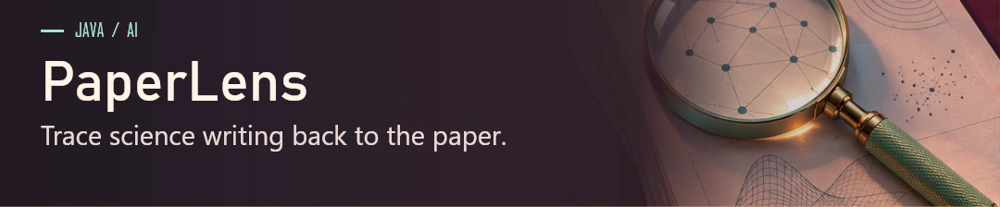</picture></a> 
  <a href="https://github.com/YoumingYang16/my-project2"><picture><source media="(max-width: 620px)" srcset="https://raw.githubusercontent.com/YoumingYang16/YoumingYang16/main/assets/portfolio/climb-mobile.webp" />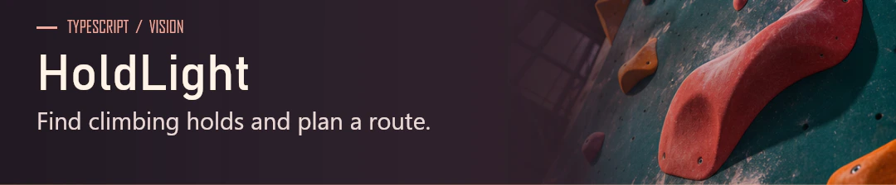</picture></a> 
  <a href="https://github.com/YoumingYang16/cockpit-hmi-studio"><picture><source media="(max-width: 620px)" srcset="https://raw.githubusercontent.com/YoumingYang16/YoumingYang16/main/assets/portfolio/cockpit-mobile.webp" />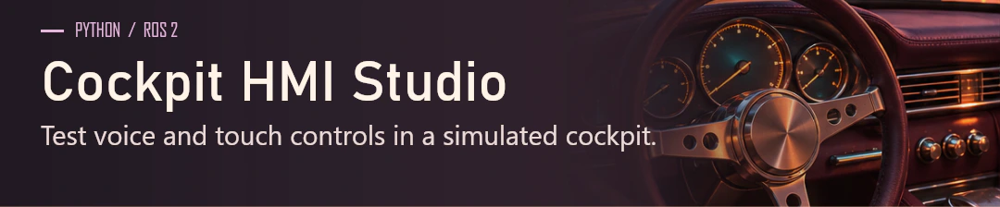</picture></a> 
  <a href="https://github.com/YoumingYang16/finmath-risk-lab"><picture><source media="(max-width: 620px)" srcset="https://raw.githubusercontent.com/YoumingYang16/YoumingYang16/main/assets/portfolio/risk-mobile.webp" />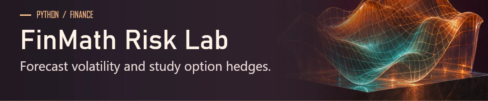</picture></a> 
  <a href="https://github.com/YoumingYang16/ros2-assistive-living"><picture><source media="(max-width: 620px)" srcset="https://raw.githubusercontent.com/YoumingYang16/YoumingYang16/main/assets/portfolio/living-mobile.webp" />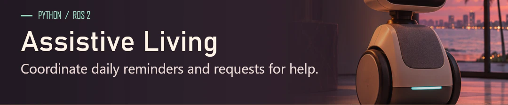</picture></a>

  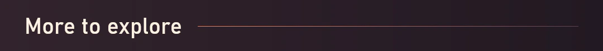 
  <a href="https://github.com/YoumingYang16/my-project1">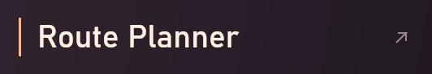</a>
   
  <a href="https://github.com/YoumingYang16/sca3-compass">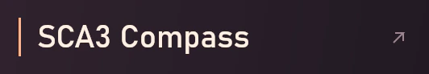</a>
  

